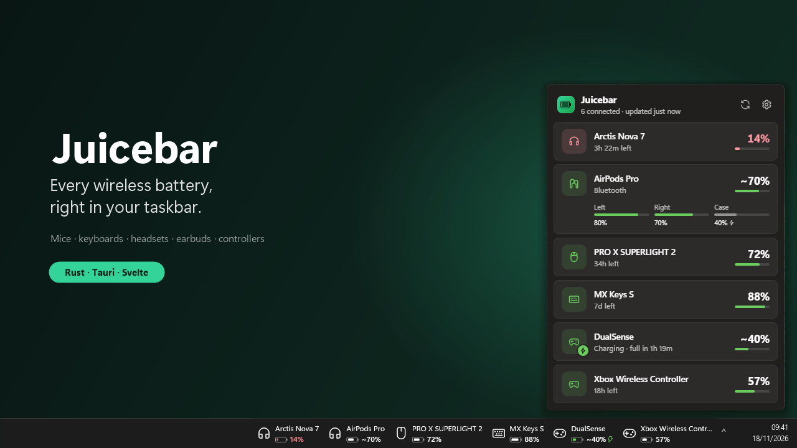
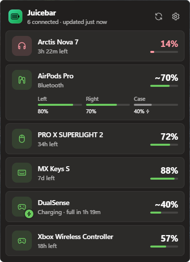
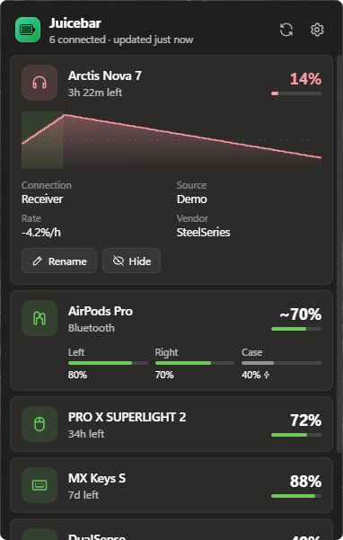
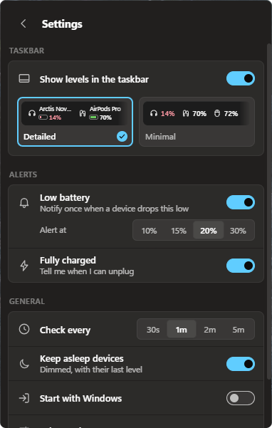
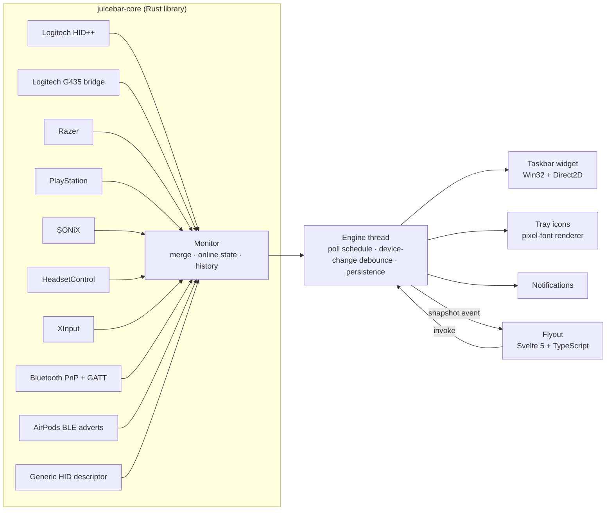

<div align="center">



<br />

[](https://github.com/andrerafaelf/juicebar/actions/workflows/ci.yml)
[](#install)
[](#architecture)
[](#architecture)
[](LICENSE)

**Battery levels of your wireless mice, keyboards, headsets, earbuds and controllers, right in the Windows taskbar.**

[Download](../../releases) · [Supported devices](#supported-devices) · [How it works](#architecture)

</div>

---

Juicebar draws a small strip of icons and percentages **inside the taskbar**, next to the notification area. It is a native layered window rendered with Direct2D, so there is no WebView running while it sits there. Click it to open a Windows 11-style flyout. The flyout shows per-device details, earbud left/right/case levels, 24-hour history and an estimate of time remaining.

### Two widget styles

<table>
  <tr>
    <td align="center"></td>
  </tr>
  <tr><td align="center"><sub><b>Detailed</b>: name, gauge and percentage on two lines, like the clock</sub></td></tr>
  <tr>
    <td align="center"></td>
  </tr>
  <tr><td align="center"><sub><b>Minimal</b>: just the icon and percentage, for crowded taskbars</sub></td></tr>
</table>

### The flyout

<table>
  <tr>
    <td align="center" width="33%"></td>
    <td align="center" width="33%"></td>
    <td align="center" width="33%"></td>
  </tr>
  <tr>
    <td align="center"><sub>Every device at a glance</sub></td>
    <td align="center"><sub>24 h history, drain rate, source</sub></td>
    <td align="center"><sub>Settings with live widget previews</sub></td>
  </tr>
</table>

<p align="center"><sub>Screenshots use the built-in demo devices (<code>npm run demo</code>).</sub></p>

## Highlights

- **Taskbar widget.** Per device: icon, name and a mini battery gauge + percentage on two lines, like the clock. A minimal style (icon + % only) fits crowded taskbars. Drawn in the taskbar with per-pixel alpha and aligned on real glyph ink bounds. It follows the light/dark taskbar theme and DPI, and re-attaches itself if Explorer restarts. Click a device to open the flyout with it expanded, or right-click for the menu.
- **Light by design.** A Rust core plus native Win32 widget. The WebView flyout is created only when opened and destroyed 45 s after it closes, so nothing heavy stays resident.
- **Many protocols, one model.** Vendor drivers, OS battery APIs, a generic HID report-descriptor parser and a HeadsetControl bridge all produce the same `Reading` type. Duplicate sightings of one device across sources are merged.
- **Smart notifications.** Low-battery alerts use hysteresis, so a device hovering at the threshold won't spam. A "fully charged" notice tells you when to unplug.
- **History and estimates.** A least-squares fit over the current discharge or charge session gives "5h 20m left" or "full in 40m".
- **Instant refresh.** It listens for device arrival/removal (`CM_Register_Notification`) instead of waiting for the next poll.
- **Tray fallback.** It shows one tray icon for the lowest battery, or one per device, crisp pixel digits at the exact DPI size. The tray icon appears automatically if the widget can't attach, for example on a vertical taskbar.
- **Remembers devices.** A device that is asleep still shows its last level, dimmed, even after a restart.
- **Rename, hide, forget** devices. Settings persist as JSON.

## Footprint

Measured on Windows 11 with a release build:

| | |
|---|---|
| Installer (NSIS) | **1.3 MB** |
| Executable | **3.6 MB** |
| Memory, idle (widget showing, flyout never opened) | **~6 MB** private, no WebView processes |
| Memory after the flyout closes | WebView processes exit after 45 s; the app keeps **~40 MB** of WebView2 runtime |
| CPU, idle | **0.00 s** over 30 s |

## Supported devices

| Source | Devices | How |
|---|---|---|
| **Logitech HID++ 2.0** | Unifying, Bolt, Lightspeed and Nano receivers; Bluetooth/wired MX & G series | Features `0x1004` Unified Battery, `0x1000` Battery Status, `0x1001` Voltage; device name & unit id for de-duplication |
| **Logitech G435** | G435 LIGHTSPEED headset (`046D:0ACB`, `046D:0ADF` dongles) | Vendor bridge to the dongle's radio SoC, battery voltage → % (≈5 % steps). Each read pauses the headset audio for ~0.5 s, so it runs every 10 min by default (configurable, or off) |
| **Razer** | Wireless mice/keyboards and their dongles | 90-byte feature-report protocol, class `0x07` (battery `0x80`, charging `0x84`) |
| **Sony** | DualShock 4, DualSense, DualSense Edge (USB + Bluetooth) | Status byte in the input report |
| **SONiX dongles** | AJAZZ / AULA 2.4 GHz keyboards (`05AC:024F`, `0C45:FEFE`) | 32-byte raw-HID query |
| **Xbox** | Controllers on the wireless adapter / USB / Bluetooth, plus headsets plugged into them | XInput |
| **Windows Bluetooth** | *Any* Bluetooth device Windows knows a battery for: headphones (HFP), BLE mice/keyboards/pens | `DEVPKEY_Bluetooth_Battery` on the device node + direct GATT Battery Service read |
| **Apple** | AirPods, AirPods Pro/Max, Beats (left / right / case) | BLE proximity-pairing advertisement (only nearby, strong signals) |
| **Generic HID** | Any device exposing a standard battery usage | Own report-descriptor parser for `0x06:0x20` Battery Strength and `0x85:0x65/0x66` State of Charge |
| **HeadsetControl** | SteelSeries Arctis, Corsair, HyperX, Logitech G, Audeze, Roccat… | Optional: uses [HeadsetControl](https://github.com/Sapd/HeadsetControl) if it is installed |
| **Linux** *(core only)* | Everything the kernel exposes | `/sys/class/power_supply/*` with `scope=Device` |

Run `juicebar-cli --dump` to see what each HID interface exposes. Most vendor protocols are implemented from public documentation. Reports from real hardware are very welcome.

## Install

Download `Juicebar_x.y.z_x64-setup.exe` from [Releases](../../releases). It installs per user, needs no admin rights, and puts an entry in the Start menu. An `.msi` is also provided.

> The installer is not code-signed yet. Windows SmartScreen may warn: choose **More info → Run anyway**. On PCs with *Smart App Control* enabled, unsigned apps cannot run at all until the build is signed.

## Architecture



```
crates/core/           battery readers, no UI dependencies (also builds on Linux)
  src/providers/       one file per protocol family
  src/hid_descriptor   HID report-descriptor parser
  src/history          samples + time-remaining estimator
  src/monitor          polling engine and de-duplication
  src/bin/juicebar-cli diagnostic CLI (--json, --dump, --watch)
src-tauri/             desktop shell
  src/widget.rs        taskbar widget (layered child of Shell_TrayWnd, Direct2D)
  src/engine.rs        monitor thread, scheduling, persistence
  src/tray.rs          tray icons;  src/icon.rs pixel-digit rasteriser
  src/popup.rs         on-demand flyout window (Mica)
src/                   Svelte 5 flyout UI
```

A few design decisions:

- **Vendor drivers claim HID interfaces.** The generic reader never sends anything to a device that has a dedicated driver. All vendor queries are read-only commands.
- **Negative caches** cover sleeping receivers, interfaces without a battery and silent dongles. They keep steady-state polls in the tens of milliseconds, and a device-change event clears them.
- **The widget is a separate Win32 thread** with its own message loop. It is a layered *child* window of the taskbar, which needs Windows 8+ compatibility declared in the app manifest (`src-tauri/app.manifest`).

## Development

Requirements: Rust (stable, MSVC), Node 20+, WebView2 (preinstalled on Windows 11).

```bash
npm install
npm run tauri dev            # run the app
npm run demo                 # simulated devices (JUICEBAR_DEMO=1), separate settings/data, 24 h of history
npm run tauri build          # NSIS installer + MSI in target/release/bundle

cargo test --workspace       # unit tests (protocol decoders, parser, estimator, alerts…)
cargo run -p juicebar-core --bin juicebar-cli -- --verbose   # scan from the terminal
cargo run -p juicebar-core --bin juicebar-cli -- --dump      # list HID interfaces
```

Adding a device family means implementing one trait:

```rust
pub trait Provider {
    fn id(&self) -> &'static str;
    fn poll(&mut self, ctx: &mut PollContext) -> Vec<Reading>;
}
```

## Credits

This is an independent re-implementation inspired by [Wireless-Device-Battery-Monitor](https://github.com/krisgfx9/Wireless-Device-Battery-Monitor). Protocol knowledge comes from Logitech's public HID++ 2.0 specifications and from the communities behind [Solaar](https://github.com/pwr-Solaar/Solaar), [OpenRazer](https://github.com/openrazer/openrazer), Linux `hid-playstation`, [HeadsetControl](https://github.com/Sapd/HeadsetControl), AirStatus/OpenPods and sonix-keyboard-studio. The G435 bridge protocol comes from endes' "USB HID down the rabbit hole" write-up, [logitech-g435-battery](https://github.com/deddroid/logitech-g435-battery) and [g435-battery-percentage](https://github.com/portyporty/g435-battery-percentage) (MIT).

## License

MIT
